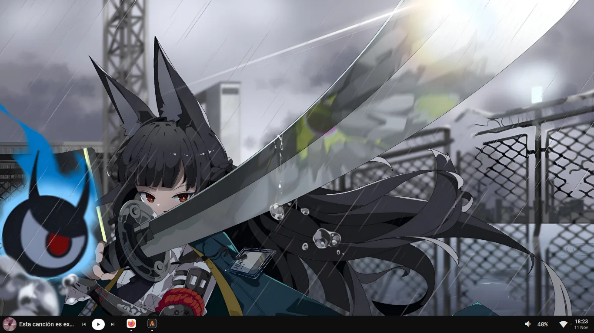
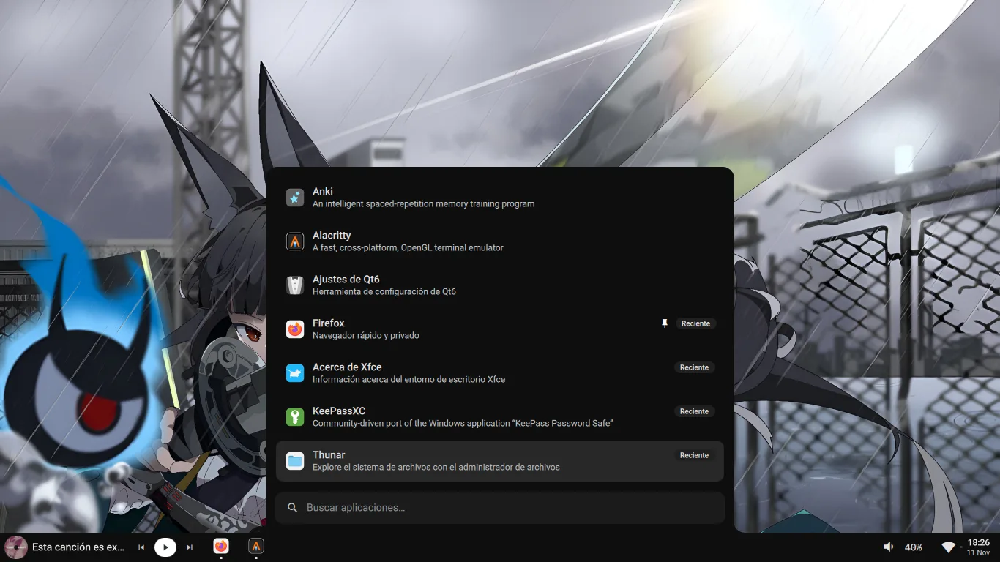
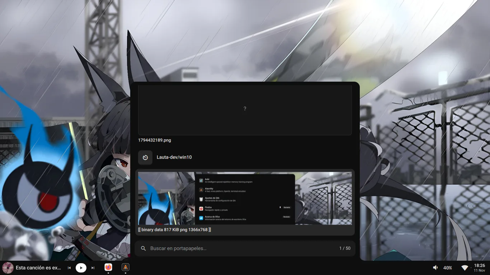
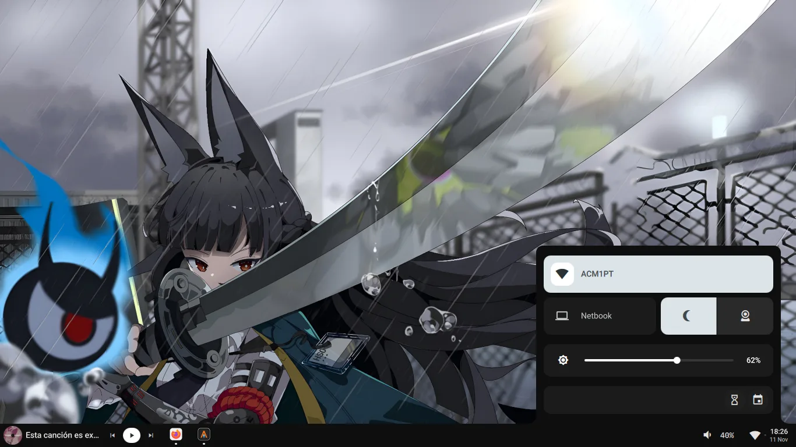
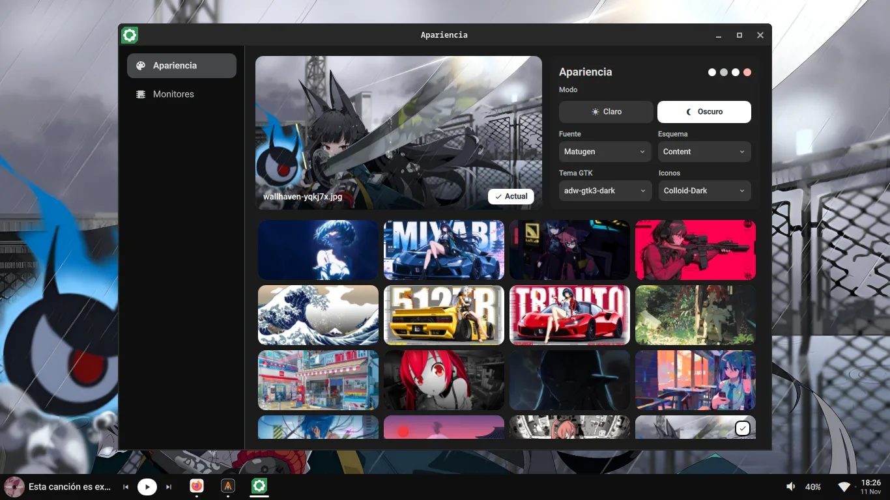
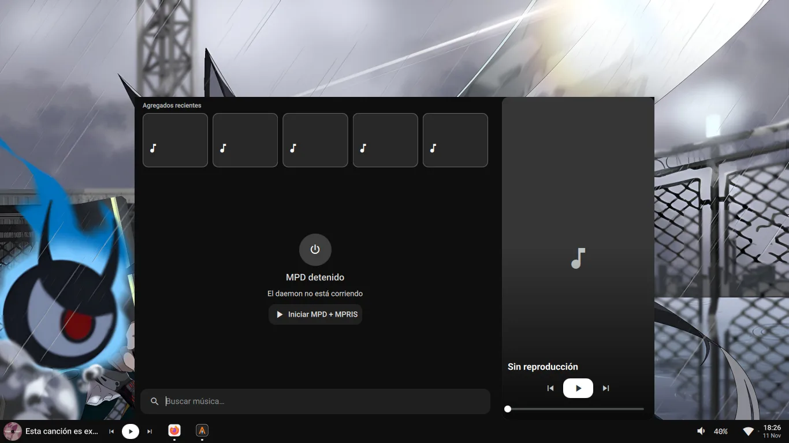
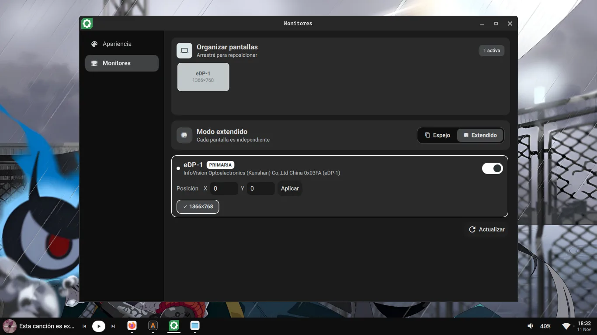

<div align="center">

# 🪟 win10

**Taskbar estilo Windows 10 / ChromeOS Material You** para **labwc** (Wayland · `wlr-layer-shell`)

-41CD52)
-111111)


</div>

> 🤖 **Proyecto 100% vibecoded — hecho por IA.** Todo el código (QML y Go) fue escrito
> por un agente de IA (OpenCode) a partir de prompts del autor: *vibecoding*, sin código
> escrito a mano. El agente mantiene este repo guiándose por [`AGENTS.md`](AGENTS.md)
> (mapa de archivos, convenciones y verificación), así que el README y el código
> suelen estar sincronizados por construcción.

<div align="center">



<em>La barra en labwc: widget MPRIS con cover, apps pineadas, volumen, WiFi y reloj.</em>

</div>

---

## ✨ Qué trae

| | |
|:---|:---|
| **🧱 Barra** | Pines con drag & drop, agrupado por app con badges de ventanas, tooltips, Jump List por hover/click, volumen con slider inline, slot MPRIS dinámico y dash del centro de control. |
| **🚀 Launcher** | AppMenu con búsqueda fuzzy, recientes, pineados y comandos rápidos (`>b`, `>ia`, `>sf`) · historial de portapapeles (cliphist) con búsqueda estilo fzf y previews de imagen. |
| **🧮 Calculadora** | Panel propio con resultado en vivo (evaluación async en Go) y fracciones exactas apiladas (num/den + gráfico de torta). |
| **🎧 Música** | MPRIS multi-player (barra + popup) · MPD con cola sobre `PanelList`, agregados recientes y cover full-bleed tintado. |
| **⚙️ Centro de control** | Usuario, tiles de ajustes, brillo, calendario/notificaciones, WiFi y pomodoro. |
| **🌗 Ajustes** | Ventana SSD con drawer de tabs: apariencia (matugen desde el wallpaper), monitores, tema oscuro y modo nocturno. |
| **El resto** | 🔔 OSD único (volumen/brillo/power) · 📝 notas con autoguardado y slash commands · 🔐 diálogo polkit. |

---

## 📸 Capturas

<sub>Click en una captura para verla a tamaño completo.</sub>

| 🚀 **AppMenu** <br><sub>búsqueda fuzzy, recientes y pineados</sub> | 📋 **Portapapeles** <br><sub>historial cliphist + previews</sub> |
|:---:|:---:|
| [](public/1794432384.webp) | [](public/1794432388.webp) |

| ⚙️ **Centro de control** <br><sub>oscuro/nocturno, brillo, pomodoro</sub> | 🌗 **Ajustes · Apariencia** <br><sub>wallpaper con matugen, GTK, iconos</sub> |
|:---:|:---:|
| [](public/1794432393.webp) | [](public/1794432400.webp) |

| 🎧 **Panel MPD** <br><sub>cola + recientes (skeleton de espera)</sub> | 🖥️ **Ajustes · Monitores** <br><sub>organizar pantallas, espejo/extendido</sub> |
|:---:|:---:|
| [](public/1794432405.webp) | [](public/1794432721.webp) |

---

## 🏗️ Arquitectura

```text
shell.qml (ShellRoot)
├── Taskbar ························ PanelWindow layer-shell anclada abajo
│   ├── taskbar/   pines + ventanas + JumpList
│   ├── widgets/   volumen · MPRIS · dash (CC)
│   └── tray/      SystemTray + DashWidget
│
├── PanelPopupHost ················· UNA sola ventana layer-shell para todos los paneles
│   ├── launcher       AppMenu │ Clipboard         ← target command-palette
│   ├── jumplist       Jump List                   ← hover/click en la barra
│   ├── music          MPRIS + cola MPD            ← widget MprisWidget
│   ├── controlcenter  Centro de control           ← DashWidget
│   ├── mpd            Cola MPD                    ← target mpd
│   └── calc           Calculadora                 ← target calc
│
├── popups con superficie propia ··· OSD · Settings · Notes · Polkit (AutoLazyLoader)
├── ipc/ ··························· targets de Quickshell IPC (los llaman los keybinds)
├── state/ ························· singletons: TaskbarState · Style · Config · …
└── services/ (Go) ················· daemons (mpd · bright · search) · calc-eval · theming · qsipc
```

**Ideas clave**

- **Carga diferida**: nada se instancia hasta su primer uso (`AutoLazyLoader`); sticky default → las vistas quedan congeladas al cerrar.
- **Un solo slot de panel**: `TaskbarState.panel` + exclusividad last-wins; abrir otro panel cambia el contenido en seco, sin re-animar.
- **Estado en `state/`**: singletons compartidos; la UI nunca habla con el sistema directamente (procesos centralizados en `state/`).
- **Estilo**: `Style.*` (Material You 3) + `Config.*` — cero colores o medidas hardcodeadas.

### Paneles grandes (`PanelPopupHost`)

| Slot (`TaskbarState.panel`) | Vista | Apertura |
|:---|:---|:---|
| `launcher` | `LauncherPopup` (AppMenu / Clipboard por modo) | IPC `command-palette` |
| `jumplist` | `JumpList` | hover/click en la tasklist |
| `music` | `MusicPopup` (MPRIS + cola) | widget MPRIS |
| `controlcenter` | `ControlCenterNew` | DashWidget |
| `mpd` | `MpdPopup` (`CpMpdView`) | IPC `mpd` · `command-palette openMpd` |
| `calc` | `CalcPopup` | IPC `calc` · `command-palette openCalc` |

---

## 🎛️ IPC

Un archivo por target en `ipc/`. **Los targets no se renombran**: los keybinds de labwc (fuera del repo) los llaman.

| Target | Archivo | Funciones |
|:---|:---|:---|
| `command-palette` | `AppMenuIpc.qml` | `toggle` `open` `close` `openClipboard` `openStartmenu` · `openMpd`/`openMusic` · `openCalc`/`openCalculator` |
| `calc` | `CalcIpc.qml` | `toggle` `open` `close` |
| `mpd` | `MpdIpc.qml` | `toggle` `open` `close` · `play` `pause` `togglePause` `next` `prev` `stop` `seek` `seekOffset` `volume` |
| `vol` | `VolumeIpc.qml` | `adjust` `toggle` |
| `bright` | `BrightIpc.qml` | `adjust` |
| `power` | `PowerIpc.qml` | `toggle` `logout` `reboot` `off` |
| `clipboard` | `ClipboardIpc.qml` | `toggle` `open` `close` |
| `notes` | `NotesIpc.qml` | `toggle` `open` `close` |

---

## 🗂️ Árbol de archivos

```text
win10/
│
├── shell.qml                       # ShellRoot — punto de entrada: Taskbar + PanelPopupHost
│                                   # siempre; el resto carga diferida (AutoLazyLoader).
├── manifest.json                   # Metadata del paquete (name, description, version).
│
├── logic/                          # Módulos JS puros (sin QML ni singletons).
│   ├── time.js                     #   formato de tiempo, clamp.
│   ├── mpd.js                      #   parseo/filtrado MPD.
│   └── startmenu.js                #   filtrado de apps, comandos, iconos por extensión.
│
├── state/                          # Singletons globales (pragma Singleton + qmldir).
│   ├── TaskbarState.qml            # Bus central de la UI (panel, activePopup, pins, OSD…).
│   ├── SettingsState.qml           # Persistencia → ~/.config/qs-settings.json.
│   ├── Style.qml · Config.qml · Icons.qml
│   │                               # Paleta MD3 · tokens de diseño · glifos.
│   ├── AudioState · MprisState     # Volumen (Pipewire) · player activo.
│   ├── MpdState · MpdConnection    # MPD: estado · bridge NDJSON al daemon Go.
│   ├── BrightState · BrightConnection
│   │                               # Brillo: estado · bridge al daemon Go.
│   ├── CalculatorState             # Motor de la calc (async, bin/calc-eval).
│   ├── ClipboardState · ClipEntry · ClipFilter · ClipProcesses
│   │                               # Portapapeles: historial, parseo, filtro, procesos.
│   ├── StartmenuState · AppLaunchState · OpenAppsState
│   │                               # Índice de apps · lanzar · ventanas abiertas.
│   ├── WifiState · MonitorState · ThemeState · WallpaperState
│   ├── PomodoroState · NotesState · PolkitState · DirBrowserState
│   └── qmldir
│
├── taskbar/                        # La barra: ventanas, tareas y pines.
│   ├── Taskbar.qml                 # PanelWindow anclada bottom + left + right.
│   ├── groups/
│   │   ├── TaskList.qml            # ListView horizontal: pinnedApps + unpinnedOpen.
│   │   └── TaskButton.qml          # Botón unificado (launcher / ventanas / ambas).
│   ├── jumplist/
│   │   ├── JumpList.qml            # Jump List estilo Win10 (panel "jumplist").
│   │   └── JumpListItem.qml        # Ítem individual.
│   └── qmldir
│
├── widgets/                        # Widgets de la barra.
│   ├── DashWidget.qml              # Trigger del CC (wifi + fecha/hora).
│   ├── MprisWidget.qml             # Slot dinámico del player activo (slide + fade).
│   ├── VolumeWidget.qml            # Ícono + slider inline (hover, sin popup).
│   └── qmldir
│
├── popups/                         # Paneles flotantes (carga diferida).
│   │                               #   Los grandes = vistas Item de PanelPopupHost;
│   │                               #   el resto = WipePopupShell (wipe minflair)
│   │                               #   + ConvexPopupShape (fusión con la barra).
│   ├── LauncherPopup.qml           # "launcher": AppMenu / Clipboard por modo.
│   ├── MpdPopup.qml                # "mpd": cola MPD (CpMpdView sobre PanelList).
│   ├── CalcPopup.qml               # "calc": calculadora con IPC propio.
│   ├── MusicPopup.qml              # "music": player MPRIS + cola MPD expandible.
│   ├── ControlCenterNew.qml        # "controlcenter": CC completo (lado right).
│   ├── OsdSliderPopup.qml          # OSD único vol/brillo/power (modo por IPC).
│   ├── SettingsPopup.qml           # Ajustes: ventana SSD con drawer, 4 tabs.
│   ├── NotesSidebar.qml            # Bloc de notas: ventana SSD, slash commands.
│   ├── PolkitPopup.qml             # Diálogo de autenticación polkit.
│   └── qmldir
│
├── components/                     # Primitivos UI reutilizables (sin lógica de negocio).
│   ├── PanelPopupHost.qml          # Superficie única de los paneles grandes (_CONFIGS).
│   ├── WipePopupShell.qml          # Shell de popups: superficie fija + wipe.
│   ├── PopupShell · PopupDrawer    # Marco de Settings (FloatingWindow + drawer de tabs).
│   ├── ConvexPopupShape.qml        # Fusión convexa popup↔barra (radios + flares).
│   ├── DismissOverlay.qml          # Cierre por click-fuera.
│   ├── AutoLazyLoader.qml          # Carga diferida sticky (vistas congeladas).
│   ├── PanelList.qml               # Lista genérica: nav teclado, vacío/cargando, hover = selección.
│   ├── DropdownMenu.qml            # Menú flotante reutilizable (rowDelegate).
│   ├── SmartSearchInput · AppTextInput · PillButton · Badge
│   │                               # Inputs, botón pill y badges.
│   ├── SeekBar · MprisControl · ValueSlider · RoundedImage
│   │                               # Piezas MPRIS y sliders.
│   ├── AppIcon · WindowCountBadge · SectionLabel · Header · EmptyState · Mouse · NoteTextArea · Drawer
│   ├── appmenu/                    # Lanzador: AppMenuView + AppDelegate.
│   ├── clipboard/                  # ClipView, ClipItemDelegate, ClipDelegate.
│   ├── calc/                       # CpCalcPanel + CpCalcFraction + CpCalcPie.
│   ├── mpd/                        # CpMpdView + CpMpdDelegate + CpRecentStrip.
│   ├── pomodoro/                   # PomodoroPanel (ring + controles).
│   ├── settings/                   # Tabs de Settings, combos, DirBrowser, TabTransition.
│   └── qmldir
│
├── tray/                           # Bandeja del sistema.
│   ├── SystemTrayArea.qml          # Repeater(SystemTray.items) + DashWidget.
│   ├── TrayIconPill.qml            # Ítem con tooltip y menú contextual.
│   └── qmldir
│
├── ipc/                            # Un archivo por target (ver tabla de arriba).
│
├── services/                       # Go 1.24 — cada carpeta es un módulo propio (con doc.md).
│   ├── daemons/                    # Un binario: mpd · bright · search (NDJSON por stdio).
│   ├── calc/                       # calc-eval: motor de la calculadora.
│   ├── theming/                    # gtk-apply · shell-theme · matugen-apply (cmd/ + internal/).
│   ├── qsipc/                      # Cliente IPC de quickshell (lo usan los keybinds de labwc).
│   ├── list-dirs · list-monitors · resolve-icons
│   │                               # JSON para DirBrowser · monitores · iconos por appId.
│
└── bin/                            # Binarios compilados (git-ignorado).
    ├── daemon · calc-eval · list-dirs · list-monitors · resolve-icons
    └── gtk-apply · shell-theme · matugen-apply · qsipc
```

---

## ✔️ Verificación

```bash
# Lint QML (con rutas de import; sin -i da falsos 255 por tipos sin resolver)
qmllint -i . -i ./state -i ./components -i ./popups -i ./taskbar \
  -i ./widgets -i ./tray -i ./ipc <archivo.qml>

# Go: vet + tests dentro de cada módulo
cd services/<módulo> && go vet ./... && go test ./...

# IPC en vivo (con la shell corriendo)
qs ipc call calc toggle
qs ipc call command-palette openClipboard
```

